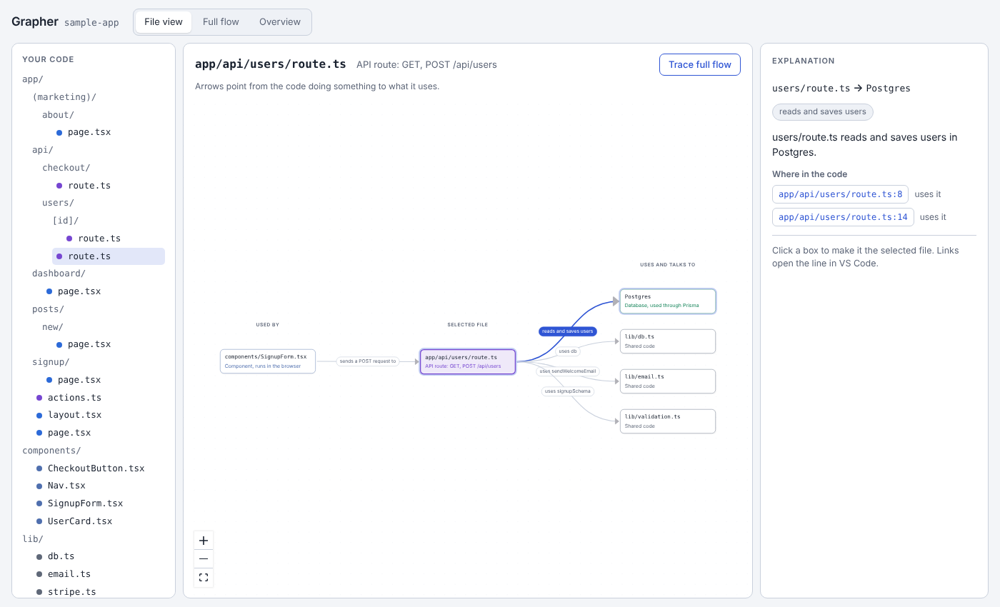
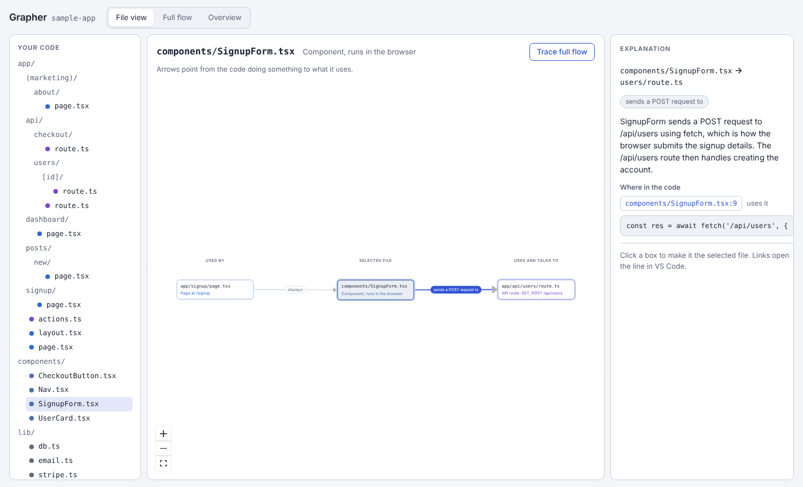
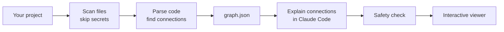

# Grapher

[](https://github.com/usmanten/grapher/actions/workflows/ci.yml)
[](https://github.com/usmanten/grapher/actions/workflows/codeql.yml)
[](https://github.com/usmanten/grapher/actions/workflows/security.yml)
[](LICENSE)

**See how your Next.js project fits together.**

Modern tools make it easy to generate a lot of code quickly. Understanding how all of it connects is harder: which page calls which API route, which route writes to the database, and where that API key is actually used. Grapher maps your project into an interactive graph you can click through, with a short plain-English explanation of every connection and a link to the exact line of code.

It is built for students and anyone still learning how real projects are structured.

> **Status:** v0.1.0, the first release. Grapher maps Next.js App Router projects (with or without a `src/` folder) written in TypeScript or JavaScript. It has been tried on a real store built with Stripe, Supabase, Shippo and Resend. See [what it supports](#what-it-supports) and the [roadmap](#roadmap).



## What it does

- **File-first map.** Pick any file and see what uses it and what it uses, including pages, API routes, databases, outside services like Stripe or Resend, and environment settings.
- **Trace a full flow.** Follow a request end to end, like _Sign up form → `POST /api/users` → Prisma → Postgres_.
- **Explains each connection.** Click a line to read two or three sentences on what it does and why, with the code that does it.
- **Never shows a secret.** Grapher can tell you that `STRIPE_SECRET_KEY` is used, but never its value. It doesn't even open your `.env` files.

## Quick start

You need [Node.js](https://nodejs.org) 22 or newer and [Claude Code](https://claude.com/claude-code). Grapher is not on npm yet, so install it from source:

```sh
git clone https://github.com/usmanten/grapher.git
cd grapher
corepack enable
pnpm install
pnpm build
pnpm grapher setup
```

`setup` installs the `/grapher` command for Claude Code. Then open Claude Code in your Next.js project and type:

```text
/grapher
```

When it finishes, open `.grapher/index.html` in your browser. Pick a file on the left to see what uses it and what it uses, click a line to read what it does, and use **Trace full flow** to follow everything that leads to and from that file. The page works offline and loads nothing from the internet.



### What `/grapher` does

1. Grapher maps the project on your machine. No code leaves it at this step.
2. If the project uses packages Grapher doesn't recognize, Claude is shown their names only and says what each one is, so an outside service like a shipping API still shows up on the map. Answers are saved in `.grapher/packages.json`.
3. Claude reads each connection Grapher found, with only the one scrubbed line of code behind it, never your files or `.env`. It writes two or three plain-English sentences for each, saved in `.grapher/explanations.json`.

Running `/grapher` again only asks about what changed, so repeat runs are quick.

### Without Claude Code

Grapher works on its own too. You get the full map, without the explanations:

```sh
pnpm grapher graph /path/to/your/nextjs-app
```

To see which files Grapher would read and which it skips, including secret files it will never open:

```sh
pnpm grapher scan /path/to/your/nextjs-app
```

```text
Scanned /home/you/my-app
  42 files ready to analyze

  Skipped:
    2 secret files (never opened): .env, .env.local
    3 dependency and build folders: .next, node_modules, out
```

Add `--json` to either command for machine-readable output. Try it on the included sample app with `pnpm grapher graph examples/sample-app`.

## What it supports

| It finds                   | For example                                                                                                                      |
| -------------------------- | -------------------------------------------------------------------------------------------------------------------------------- |
| Pages, layouts, API routes | `app/page.tsx`, `app/api/users/route.ts` and the HTTP methods each route handles                                                 |
| Components a page displays | `<SignupForm />` in a page                                                                                                       |
| Links between pages        | `<Link href="/about">`, `router.push`, `redirect()`, a Stripe checkout's `success_url`                                           |
| Calls to your API routes   | `fetch('/api/users', { method: 'POST' })`, axios, ky                                                                             |
| Server actions             | Files marked `'use server'`                                                                                                      |
| Databases and their tables | Prisma, Drizzle and Supabase (which tables are read, saved or deleted), plus Postgres, MongoDB, Redis and others by package      |
| Outside services           | Stripe, Resend, Shippo, OpenAI and more than 30 others by package, outside web APIs by host, and anything else Claude identifies |
| Settings                   | `process.env.STRIPE_SECRET_KEY`, by name only                                                                                    |

**Python** gets a full map too:

| It finds                   | For example                                                                                                                                                                |
| -------------------------- | -------------------------------------------------------------------------------------------------------------------------------------------------------------------------- |
| Web routes                 | `@app.route('/login', methods=['POST'])` in Flask, `@router.get('/{id}')` in FastAPI, `path('blog/', ...)` in Django, with blueprint and router prefixes                   |
| Databases and their tables | SQLAlchemy, Flask-SQLAlchemy, SQLModel and the Django ORM (which tables are read, saved or deleted), hand-written SQL, plus Postgres, MongoDB, Redis and others by package |
| Outside services           | Stripe, OpenAI, AWS and others by package, outside web APIs called with `requests` or `httpx`, and anything else Claude identifies                                         |
| Settings                   | `os.environ['NAME']`, `os.getenv('NAME')`, python-decouple, django-environ and pydantic settings, by name only                                                             |

Other languages get a basic map: for Java, Go, Rust, C and C++, Ruby and PHP, Grapher shows which file uses which, but not yet routes, databases, services or settings.

Not yet supported: the Pages Router (`pages/`, Grapher shows a warning).

## How it works



1. **Scan.** Grapher lists your project's files, skipping dependencies, build output, anything in `.gitignore`, and every secret file.
2. **Parse.** It reads your code with the TypeScript compiler to find real connections, so every arrow points to an actual line.
3. **Explain.** Inside Claude Code, the `/grapher` command writes a short explanation for each connection from a small, scrubbed snippet.
4. **Check and view.** Everything is checked for secret-like values before it is saved, then opened as a single interactive page.

More detail is in [docs/architecture.md](docs/architecture.md).

## Privacy and secrets

Grapher's core promise is that **it may show a secret's name, never its value.**

- Files like `.env`, `.env.local`, `*.pem`, `*.key` and credential JSON files are never opened. Templates like `.env.example` are allowed.
- All file reads go through one gate that refuses secret files, symlinks and anything outside your project.
- Each connection shows just the one line of code behind it. Anything in that line that looks like a key, token, password or private key is replaced with `[hidden]`.
- Before saving, Grapher checks everything it is about to write. If anything still looks like a secret, it stops and saves nothing, and the error says where without repeating the value.
- The Grapher program makes no network requests. Your code stays on your machine.

See [SECURITY.md](SECURITY.md) and the [threat model](docs/threat-model.md) for details, and to report a problem privately.

## Roadmap

- [x] Project scanner with secret-file protection
- [x] Connection detection: imports, pages, links between pages, API routes, fetch calls, server actions, Prisma, Drizzle, Supabase, outside services, settings
- [x] Interactive viewer with file view, full-flow tracing and an overview
- [x] `/grapher` command for Claude Code with cached explanations
- [x] Snippet scrubbing and a final output safety check
- [x] Tried on a real project, with page links, Supabase functions and AI-identified packages added from what it found
- [x] v0.1.0 release

Next: publishing to npm, marking files nothing uses, Pages Router support, full maps for more languages, a "what changed since the last commit" view, and watch mode.

## Contributing

Contributions are welcome. Read [CONTRIBUTING.md](CONTRIBUTING.md) to get set up, and follow the [Code of Conduct](CODE_OF_CONDUCT.md).

## License

[MIT](LICENSE) © 2026 Usman
