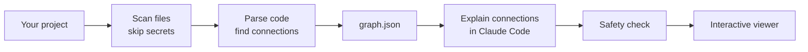

# Grapher

[](https://github.com/usmanten/grapher/actions/workflows/ci.yml)
[](https://github.com/usmanten/grapher/actions/workflows/codeql.yml)
[](https://github.com/usmanten/grapher/actions/workflows/security.yml)
[](LICENSE)

**See how your Next.js project fits together.**

Modern tools make it easy to generate a lot of code quickly. Understanding how all of it connects is harder: which page calls which API route, which route writes to the database, and where that API key is actually used. Grapher maps your project into an interactive graph you can click through, with a short plain-English explanation of every connection and a link to the exact line of code.

It is built for students and anyone still learning how real projects are structured.

> **Status:** early development. The scanner and connection detection work today. The graph, viewer and explanations are being built. See the [roadmap](#roadmap).

<!-- Screenshot of the viewer goes here once it ships in v0.1. -->

## What it does

- **File-first map.** Pick any file and see what uses it and what it uses, including pages, API routes, databases, outside services like Stripe or Resend, and environment settings.
- **Trace a full flow.** Follow a request end to end, like _Sign up form → `POST /api/users` → Prisma → Postgres_.
- **Explains each connection.** Click a line to read two or three sentences on what it does and why, with the code that does it.
- **Never shows a secret.** Grapher can tell you that `STRIPE_SECRET_KEY` is used, but never its value. It doesn't even open your `.env` files.

## Quick start

Grapher is not published to npm yet. To try the scanner from source:

```sh
git clone https://github.com/usmanten/grapher.git
cd grapher
corepack enable
pnpm install
pnpm build
pnpm grapher scan /path/to/your/nextjs-app
```

Example output:

```text
Scanned /home/you/my-app
  42 files ready to analyze

  Skipped:
    2 secret files (never opened): .env, .env.local
    3 dependency and build folders: .next, node_modules, out
```

Add `--json` for machine-readable output.

To map how the project connects and save it to `.grapher/graph.json`:

```sh
pnpm grapher graph /path/to/your/nextjs-app
```

Try it on the included sample app with `pnpm grapher graph examples/sample-app`.

## How it works



1. **Scan.** Grapher lists your project's files, skipping dependencies, build output, anything in `.gitignore`, and every secret file.
2. **Parse.** It reads your code with the TypeScript compiler to find real connections, so every arrow points to an actual line.
3. **Explain.** Inside Claude Code, the `/grapher` command writes a short explanation for each connection from a small, scrubbed snippet.
4. **Check and view.** Everything is checked for secret-like values before it is saved, then opened as a single interactive page.

More detail is in [docs/architecture.md](docs/architecture.md).

## Privacy and secrets

Grapher's core promise is that **it may show a secret's name, never its value.**

- Files like `.env`, `.env.local`, `*.pem`, `*.key` and credential JSON files are never opened. Templates like `.env.example` are allowed.
- All file reads go through one gate that refuses secret files, symlinks and anything outside your project.
- The Grapher program makes no network requests. Your code stays on your machine.

See [SECURITY.md](SECURITY.md) and the [threat model](docs/threat-model.md) for details, and to report a problem privately.

## Roadmap

- [x] Project scanner with secret-file protection
- [x] Connection detection: imports, pages, API routes, fetch calls, server actions, Prisma, Drizzle, Supabase, outside services, settings
- [ ] Interactive viewer with file view, full-flow tracing and an overview
- [ ] `/grapher` command for Claude Code with cached explanations
- [ ] Snippet scrubbing and a final output safety check
- [ ] v0.1.0 release

Later: a "what changed since the last commit" view, Pages Router support, Python projects, and watch mode.

## Contributing

Contributions are welcome. Read [CONTRIBUTING.md](CONTRIBUTING.md) to get set up, and follow the [Code of Conduct](CODE_OF_CONDUCT.md).

## License

[MIT](LICENSE) © 2026 Usman
