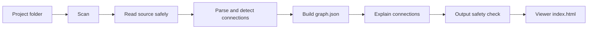

# Architecture

Grapher turns a Next.js project into a graph of how its pieces connect, and explains each connection in plain English. This document describes how the code is organized and how data flows through it. Product decisions live in [plan.md](plan.md), and the reasoning behind significant choices lives in [decisions/](decisions/).

## Pipeline



| Stage        | Status | What it does                                                                                         |
| ------------ | ------ | ---------------------------------------------------------------------------------------------------- |
| Scan         | Done   | Lists the files that may be analyzed, skipping secrets, dependencies, build output and ignored files |
| Read safely  | Done   | The only way to read file contents. Re-checks every rule at read time                                |
| Parse        | Done   | Uses ts-morph to resolve imports, including path aliases like `@/lib/db`                             |
| Detect       | Done   | Finds pages, API routes, fetch calls, server actions, database code, outside services and settings   |
| Graph        | Done   | Writes a versioned `graph.json` with nodes, connections and file:line locations                      |
| Explain      | Done   | The `/grapher` command in Claude Code writes short explanations from scrubbed snippets               |
| Safety check | Done   | Scans everything Grapher writes for secret-like values and refuses to save if any are found          |
| Viewer       | Done   | A single self-contained HTML page built with React and React Flow                                    |

## Packages

```
packages/
  core/   scanning, analysis and safety checks; everything that touches user files
  cli/    the `grapher` command, a thin layer over core
  viewer/ the page written to .grapher/index.html (React + React Flow, one self-contained file)
```

`core` has no knowledge of the terminal, and `cli` has no knowledge of file rules. This keeps the security-sensitive code in one place, where it is easiest to test and review.

## The scanner (`packages/core/src/scan`)

- **`scan.ts`** walks the project from the root. It lists directories, reads `.gitignore` files, and records every file it approves along with everything it skips and why. It reads no other file contents.
- **`denylist.ts`** decides which files are secret (`.env*`, keys, certificates, credential files) and which folders only hold credentials (`.ssh`, `.aws`). Secret files are skipped even if a `.gitignore` rule would include them.
- **`gitignore.ts`** applies root and nested `.gitignore` files the way git does, including `!` negation.
- **`reader.ts`** is the single gate for reading file contents. It only reads files the scan approved, and at read time it checks again that the file is not secret, not a symlink, not too large, and still inside the project.
- **`fs.ts`** is the small file-system interface everything above uses. Tests swap in a recording version to prove which files were opened.

### Why symlinks are never followed

A symlink can point anywhere, including outside the project or at a secret file with an innocent name. Skipping them entirely is simpler and safer than trying to resolve and re-check them. The project root itself may be a symlink. It is resolved once, up front.

## Analysis (`packages/core/src/analyze`)

- **`project.ts`** loads every approved code file through the safe reader into a ts-morph project that lives only in memory (see [ADR 0006](decisions/0006-in-memory-parsing.md)). Path aliases come from `tsconfig.json` or `jsconfig.json`; `extends` is not followed.
- **`next.ts`** knows the App Router conventions: which files are pages, layouts and routes, and which URL a route answers (route groups like `(marketing)` and `@slots` are dropped).
- **`detectors/`** each look for one kind of connection: `imports`, `requests` (fetch, axios, ky), `navigation` (links, redirects and return addresses that open one of the app's pages), `settings` (`process.env`), `packages` (known services and databases), and `databases` (Prisma, Drizzle, Supabase tables and whether code reads, saves or deletes, plus Supabase database functions).
- **`builder.ts`** merges everything found between the same two nodes into one connection with one plain-word label, like "reads and saves users", keeping up to five code locations. Output is sorted so the same project always produces the same file.

The output writer (`packages/core/src/output`) saves `.grapher/graph.json`, adds a `.gitignore` inside `.grapher/` so the folder is never committed, and refuses to write through a symlink.

## Secret safety (`packages/core/src/safety`)

- **`detect.ts`** finds secret-looking text: published key formats (Stripe, OpenAI, Anthropic, AWS, GitHub and others), private key blocks, logins inside URLs, values assigned to names like `password` or `apiKey`, and long random-looking strings. `scrub` replaces each match with `[hidden]`.
- **`check.ts`** walks everything about to be written and reports where a match is and what kind it is, never the value. `assertNoSecrets` throws when anything matches.
- **`analyze/snippets.ts`** adds one scrubbed line of code to each connection location, cut to 160 characters.

`writeGraph` and `renderViewer` both call `assertNoSecrets`, and the CLI builds and checks both outputs before writing either, so a failed check leaves nothing half-written (see [ADR 0008](decisions/0008-scrub-and-fail-closed.md)).

## Explanations (`packages/core/src/explain`, `packages/cli/src/explain.ts`)

The Grapher CLI never talks to an AI service itself ([ADR 0003](decisions/0003-no-network-in-cli.md)). Instead, the `/grapher` command runs inside the user's own Claude Code session, and the two exchange files ([ADR 0009](decisions/0009-explanations-through-claude-code.md)):

1. `grapher explain` maps the project, writes the page, and prints an **explain request**: up to 40 connections that have no up-to-date explanation, each with its two ends, its label and its scrubbed code lines. The request is checked for secrets before it is printed, and the data sits between marker lines containing a random value.
2. Claude writes `{ "<connection id>": "<explanation>" }` to `.grapher/answers.json`.
3. `grapher explain --save` keeps answers only for connections that were asked about, cleans them to plain text of at most 600 characters, refuses the whole answer if anything looks like a secret, and stores them in `.grapher/explanations.json`.
4. Each explanation is saved with a **fingerprint** of its connection (kind, label, tables and code lines, not line numbers). When the code changes, the fingerprint changes and the connection is explained again; otherwise the saved text is reused, so repeat runs cost almost nothing.

`grapher setup` installs the command file at `~/.claude/commands/grapher.md`, filled in with the path to this CLI. It only ever replaces a file it wrote itself.

## The viewer (`packages/viewer`)

The viewer is a React app built with Vite into a single HTML file, `dist/template.html`, with all of its code and styles inlined. When `grapher graph` runs, the CLI fills that template with the project's data and saves it as `.grapher/index.html` (see [ADR 0007](decisions/0007-single-file-viewer.md)).

- **`model.ts`** holds the pure logic: which nodes and lines each view shows, how columns are ranked so lines flow left to right, the file tree, plain-English descriptions, and "open in VS Code" links. It is unit tested without a browser.
- **`data.ts`** reads the embedded data and drops anything malformed, since it came from the user's project.
- **`components/`** are the three panes: the file tree, the React Flow canvas, and the explanation panel.
- **`scripts/finalize.js`** runs after the build. It computes a hash of the inlined script and stylesheet and writes the page's Content Security Policy, so the browser runs that exact code and nothing else.

The data goes in a `<script type="application/json">` element. Browsers never run it, and `renderViewer` in core escapes `<`, `>` and `&` so a file name like `</script>` can't break out of it. React escapes every string it shows, and the viewer never sets raw HTML.

## Data model

`ScanResult` is the contract between the scanner and later stages:

```ts
interface ScanResult {
  root: string; // absolute, symlink-resolved project root
  files: { path: string; size: number }[]; // relative paths with forward slashes, sorted
  skipped: { path: string; reason: SkipReason }[];
  truncated: boolean; // true if the scan hit the file limit
}
```

Paths are relative and use forward slashes on every platform, so output is stable across machines and easy to diff.

`graph.json` is described by [`packages/core/schema/graph.schema.json`](../packages/core/schema/graph.schema.json) and carries a `schemaVersion`. In short:

- **Nodes** are files (with a role such as page, route or component, and a URL for pages and routes), databases, outside services, and settings (a name and whether it is public, never a value).
- **Connections** go from the code doing the action to what it uses. Each has a kind, a plain-word label, optional details (tables or HTTP methods) and up to five `path:line` locations.
- **Warnings** flag things like a Pages Router project or a file that failed to parse, and `unknownPackages` lists packages Grapher could not classify, by name only.
