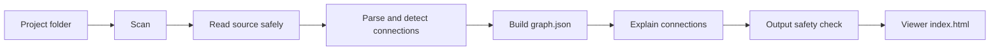

# Architecture

Grapher turns a Next.js project into a graph of how its pieces connect, and explains each connection in plain English. This document describes how the code is organized and how data flows through it. Product decisions live in [plan.md](plan.md), and the reasoning behind significant choices lives in [decisions/](decisions/).

## Pipeline



| Stage        | Status  | What it does                                                                                         |
| ------------ | ------- | ---------------------------------------------------------------------------------------------------- |
| Scan         | Done    | Lists the files that may be analyzed, skipping secrets, dependencies, build output and ignored files |
| Read safely  | Done    | The only way to read file contents. Re-checks every rule at read time                                |
| Parse        | Done    | Uses ts-morph to resolve imports, including path aliases like `@/lib/db`                             |
| Detect       | Done    | Finds pages, API routes, fetch calls, server actions, database code, outside services and settings   |
| Graph        | Done    | Writes a versioned `graph.json` with nodes, connections and file:line locations                      |
| Explain      | Planned | The `/grapher` command in Claude Code writes short explanations from scrubbed snippets               |
| Safety check | Planned | Scans everything Grapher writes for secret-like values and refuses to save if any are found          |
| Viewer       | Planned | A single self-contained HTML page built with React and React Flow                                    |

## Packages

```
packages/
  core/   scanning, analysis and safety checks; everything that touches user files
  cli/    the `grapher` command, a thin layer over core
```

`core` has no knowledge of the terminal, and `cli` has no knowledge of file rules. This keeps the security-sensitive code in one place, where it is easiest to test and review.

## The scanner (`packages/core/src/scan`)

- **`scan.ts`** walks the project from the root. It lists directories, reads `.gitignore` files, and records every file it approves along with everything it skips and why. It reads no other file contents.
- **`denylist.ts`** decides which files are secret (`.env*`, keys, certificates, credential files) and which folders only hold credentials (`.ssh`, `.aws`). Secret files are skipped even if a `.gitignore` rule would include them.
- **`gitignore.ts`** applies root and nested `.gitignore` files the way git does, including `!` negation.
- **`reader.ts`** is the single gate for reading file contents. It only reads files the scan approved, and at read time it checks again that the file is not secret, not a symlink, not too large, and still inside the project.
- **`fs.ts`** is the small file-system interface everything above uses. Tests swap in a recording version to prove which files were opened.

### Why symlinks are never followed

A symlink can point anywhere, including outside the project or at a secret file with an innocent name. Skipping them entirely is simpler and safer than trying to resolve and re-check them. The project root itself may be a symlink. It is resolved once, up front.

## Analysis (`packages/core/src/analyze`)

- **`project.ts`** loads every approved code file through the safe reader into a ts-morph project that lives only in memory (see [ADR 0006](decisions/0006-in-memory-parsing.md)). Path aliases come from `tsconfig.json` or `jsconfig.json`; `extends` is not followed.
- **`next.ts`** knows the App Router conventions: which files are pages, layouts and routes, and which URL a route answers (route groups like `(marketing)` and `@slots` are dropped).
- **`detectors/`** each look for one kind of connection: `imports`, `requests` (fetch, axios, ky), `settings` (`process.env`), `packages` (known services and databases), and `databases` (Prisma, Drizzle, Supabase tables and whether code reads, saves or deletes).
- **`builder.ts`** merges everything found between the same two nodes into one connection with one plain-word label, like "reads and saves users", keeping up to five code locations. Output is sorted so the same project always produces the same file.

The output writer (`packages/core/src/output`) saves `.grapher/graph.json`, adds a `.gitignore` inside `.grapher/` so the folder is never committed, and refuses to write through a symlink.

## Data model

`ScanResult` is the contract between the scanner and later stages:

```ts
interface ScanResult {
  root: string; // absolute, symlink-resolved project root
  files: { path: string; size: number }[]; // relative paths with forward slashes, sorted
  skipped: { path: string; reason: SkipReason }[];
  truncated: boolean; // true if the scan hit the file limit
}
```

Paths are relative and use forward slashes on every platform, so output is stable across machines and easy to diff.

`graph.json` is described by [`packages/core/schema/graph.schema.json`](../packages/core/schema/graph.schema.json) and carries a `schemaVersion`. In short:

- **Nodes** are files (with a role such as page, route or component, and a URL for pages and routes), databases, outside services, and settings (a name and whether it is public, never a value).
- **Connections** go from the code doing the action to what it uses. Each has a kind, a plain-word label, optional details (tables or HTTP methods) and up to five `path:line` locations.
- **Warnings** flag things like a Pages Router project or a file that failed to parse, and `unknownPackages` lists packages Grapher could not classify, by name only.
